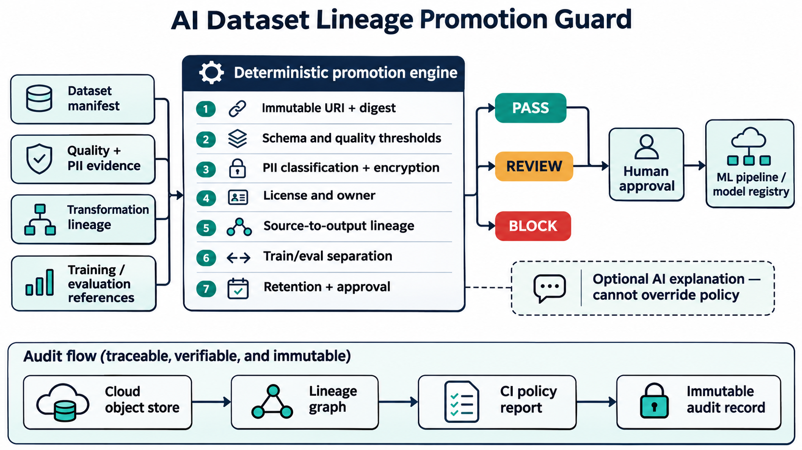

# AI Dataset Lineage Promotion Guard

A deterministic CI gate that blocks untraceable, low-quality, or unapproved datasets before they enter an AI training or evaluation pipeline.



## Production problem

Model artifacts can be signed and versioned while the data that produced them remains mutable, poorly documented, or impossible to reproduce. That creates operational, privacy, licensing, and audit risk. During an incident, teams need to answer which exact dataset, transformation code, split, and approval produced a model candidate.

This project validates that evidence before promotion. It complements model-supply-chain controls by protecting the upstream dataset path.

## Why this matters now

Current ML-platform roles repeatedly call for lineage, reproducibility, data quality, Kubernetes/cloud infrastructure, CI/CD, and governance. AWS and Google Cloud lineage services explicitly connect datasets, pipeline runs, training jobs, evaluations, models, and endpoints so workflows can be reproduced and audited.

## Checks

- versioned cloud-object URI plus SHA-256 digest
- versioned schema and format
- completeness, validity, and duplicate-rate thresholds
- content-addressed quality report
- privacy classification, PII scan, and encryption
- license, owner, and approved usage
- content-addressed sources and reproducible transformations
- distinct training, validation, and test splits
- links to training, evaluation, and model-candidate runs
- retention, deletion, human approval, and immutable audit evidence

## Quick start

```bash
python -m venv .venv
source .venv/bin/activate
pip install -e . pytest
pytest -q
dataset-lineage-guard samples/compliant-manifest.yaml
```

PASS exits `0`; REVIEW and BLOCK exit `2` for CI enforcement.

## Measurable outcomes

Track dataset promotion coverage, unsafe promotions blocked, lineage completeness, time to reproduce a training run, PII-policy violations, split-overlap detections, audit response time, and false positives. Suggested targets: 100% production dataset coverage, zero unapproved mutable datasets, and under 15 minutes to trace a model candidate to its exact dataset and transformation run.

## Security and failure modes

The guard is offline and makes no cloud or pipeline mutation. It does not inspect raw records or secrets. A passing manifest cannot prove the referenced object exists, the digest is correct, or the quality scanner is trustworthy; production integration should verify object metadata, signatures, access policy, and audit-record immutability. AI may explain findings but cannot approve promotion.

## Interview positioning

Use the project to discuss data lineage as a platform capability, deterministic policy, reproducibility, privacy-by-default controls, split leakage, evidence correlation, CI enforcement, and the boundary between automated analysis and human approval.

See [research](docs/research.md) and [safe deployment guidance](docs/deployment.md).
