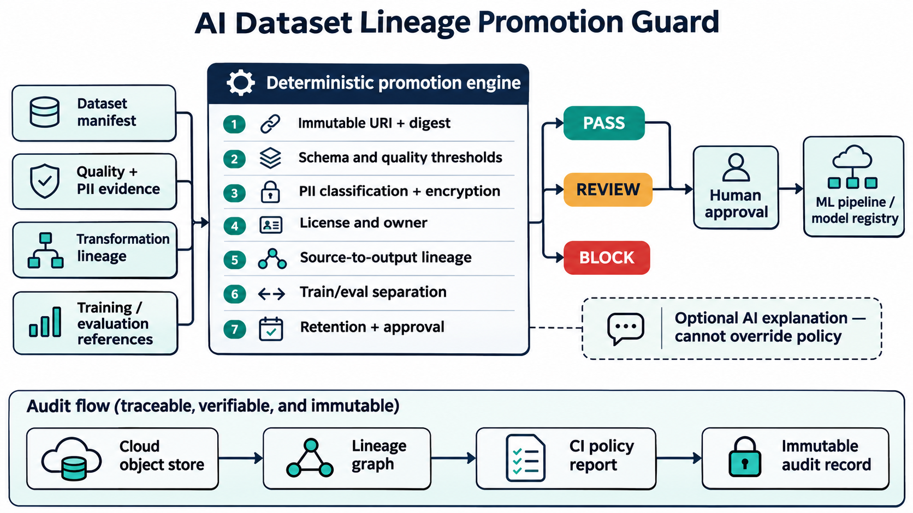

# Enforcing AI Dataset Lineage Before Model Training

A model can be signed, versioned, and deployed through GitOps while the dataset behind it remains mutable or poorly documented. That leaves platform teams unable to reproduce behavior, investigate regressions, verify privacy controls, or prove which transformations produced a model candidate.

## Why this matters now

Current ML-platform roles combine data lineage, reproducibility, quality, cloud infrastructure, Kubernetes, CI/CD, and governance. AWS and Google Cloud lineage services explicitly connect datasets, pipeline executions, training jobs, evaluations, models, and endpoints because reproducibility is an operational requirement.

## Implementation

AI Dataset Lineage Promotion Guard reads a promotion manifest and emits PASS, REVIEW, or BLOCK. It validates immutable object identity, SHA-256 evidence, versioned schemas, quality thresholds, privacy classification, PII scans, encryption, licensing, ownership, source and transformation lineage, split separation, workflow references, retention, approval, and immutable audit records.

The policy engine is deterministic and offline. AI can create a human-readable explanation, but it cannot modify the evidence or decision.

## Tests and validation

Fifteen tests cover the compliant path plus unversioned objects, bad digests, missing schemas, quality failures, missing reports, PII failures, encryption gaps, unapproved licensing, broken lineage, split overlap, missing run references, invalid retention, missing approval, and mutable audit records. GitHub Actions runs the suite and evaluates the compliant manifest.

## Deployment and security

Generate the manifest after quality and PII scans, run the gate before promotion, verify object metadata with read-only cloud APIs, and write signed reports to immutable storage. Use workload identity and separation of duties. Human approval remains mandatory for production promotion and exceptions.

Static evidence has limits: a manifest cannot prove a referenced object exists or that a scanner is trustworthy. Add integration checks and periodically rebuild historical model candidates to measure real reproducibility.

## Outcomes and interview positioning

Measure promotion coverage, lineage completeness, unsafe datasets blocked, split leakage, audit response time, reproduction time, and false positives. In interviews, this project demonstrates cloud data governance, MLOps platform design, deterministic policy, privacy and licensing controls, CI automation, and production-minded trade-offs.

Repository: https://github.com/ohjeffkuston/ai-dataset-lineage-promotion-guard
